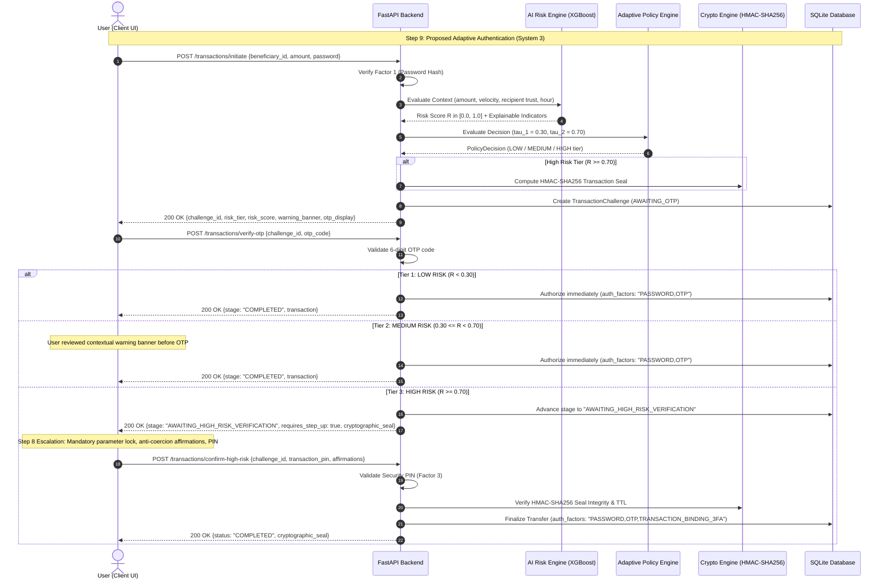

# ATAF — Step 9: Integrate the Proposed System (System 3)

## Overview

**Step 9** of the **Adaptive Transaction Authentication Framework (ATAF)** delivers **System 3: Working Proposed Adaptive Authentication System**.

This system represents the culmination of Steps 1 through 8, unifying the simulated banking platform, machine learning risk inference, adaptive policy decision matrix, and transaction-bound cryptographic verification into an intelligent, dynamic authentication pipeline:

$$\text{Banking App} \longrightarrow \text{Password + OTP} \longrightarrow \text{Transaction} \longrightarrow \text{AI Risk Engine} \longrightarrow \text{Risk Score} \longrightarrow \text{Adaptive Security Policy} \longrightarrow \text{Additional Verification (if needed)} \longrightarrow \text{Authorization}$$

### Project Domain & Responsibility
* **Domain:** AI + Cybersecurity + Software Engineering
* **Responsible:** All
* **Input:** Components from Steps 1–8
  - `Step1`: Core banking application & SQLite database
  - `Step2`: Baseline authentication flow (Password $\to$ OTP)
  - `Step3`: Static 3FA comparison baseline
  - `Step4`: IEEE-CIS fraud detection feature schema
  - `Step5` & `Step6`: Trained XGBoost model (`Step5/models/xgboost.pkl`, ROC-AUC 0.9468)
  - `Step7`: Adaptive Security Policy Engine with calibrated cutoffs ($\tau_1 = 0.30, \tau_2 = 0.70$)
  - `Step8`: PSD2 Art. 97 & NIST SP 800-63B HMAC-SHA256 Transaction-Bound Verification mechanism
* **Goal:** Create the complete proposed system (**System 3**).
* **Output:** Full working banking application with live React frontend and FastAPI backend.

---

## Authentication Protocol Flow



---

## Adaptive Policy Decision Matrix

| Risk Tier | Risk Score $R$ | Enforcement Directive | Factors Required | User Experience Impact |
|---|---|---|---|---|
| 🟢 **LOW RISK** | $R < 0.30$ | Standard 2FA | Password + OTP | **Zero added friction.** Routine transfers complete instantly. |
| 🟡 **MEDIUM RISK** | $0.30 \le R < 0.70$ | Contextual Warning | Password + Advisory Banner + OTP | **Nudge friction.** Alerts victim against social-engineering phone calls without blocking workflow. |
| 🔴 **HIGH RISK** | $R \ge 0.70$ | Strong Step-Up (3FA) | Password + OTP + Transaction-Bound Seal + Affirmations + PIN | **Hard stop friction.** Locks recipient and amount, demands anti-coercion affirmation, and checks 4-digit PIN. |

---

## API Endpoints

| Method | Endpoint | Auth Required | Purpose |
|---|---|---|---|
| `POST` | `/transactions/initiate` | Bearer Token | Authenticates password, triggers AI scoring, returns policy tier and OTP. |
| `POST` | `/transactions/verify-otp` | Bearer Token | Verifies OTP; completes LOW/MEDIUM risk or steps up HIGH risk. |
| `POST` | `/transactions/confirm-high-risk` | Bearer Token | Validates affirmations, security PIN, and HMAC seal for HIGH risk transfers. |
| `POST` | `/transactions/resend-otp` | Bearer Token | Issues a fresh OTP code for active challenge session. |
| `POST` | `/transactions/cancel` | Bearer Token | Aborts an active transfer challenge. |
| `GET` | `/transactions` | Bearer Token | Fetches user transaction audit trail with risk scores and factors enforced. |
| `POST` | `/account/pin` | Bearer Token | Configures or updates the 4-digit Transaction Security PIN. |

---

## How to Run Step 9

### 1. Backend Setup & Execution
```bash
cd Step9/backend

# Create virtual environment with Python 3.12:
uv venv --python 3.12

# Activate environment:
source .venv/bin/activate         # Bash / Zsh
source .venv/bin/activate.fish    # Fish shell

# Install dependencies:
uv pip install -r requirements.txt

# Run integration test suite:
pytest test_adaptive_system.py -v

# Start the FastAPI server (Port 8000):
python run.py
```
* Interactive API Documentation: [http://127.0.0.1:8000/docs](http://127.0.0.1:8000/docs)

### 2. Frontend Setup & Execution
```bash
cd Step9/frontend

# Install dependencies:
npm install

# Start Vite dev server (Port 5173 or 5174):
npm run dev
```
* Web Application: [http://localhost:5173](http://localhost:5173)

---

## Verification & Test Results

The backend test suite (`test_adaptive_system.py`) validates:
1. `test_scenario_low_risk_flow`: Routine grocery transfer ($R < 0.30$) completes with standard 2FA without prompting Factor 3.
2. `test_scenario_medium_risk_flow`: Moderate transfer ($0.30 \le R < 0.70$) displays anti-social-engineering warning banner and completes upon OTP verification.
3. `test_scenario_high_risk_flow`: Large anomalous transfer ($R \ge 0.70$) dynamically halts upon OTP, requires explicit anti-coercion affirmations and security PIN, and validates HMAC-SHA256 seal.
4. `test_transactions_history`: Verifies comprehensive audit logging of all authentication factors and risk scores.
